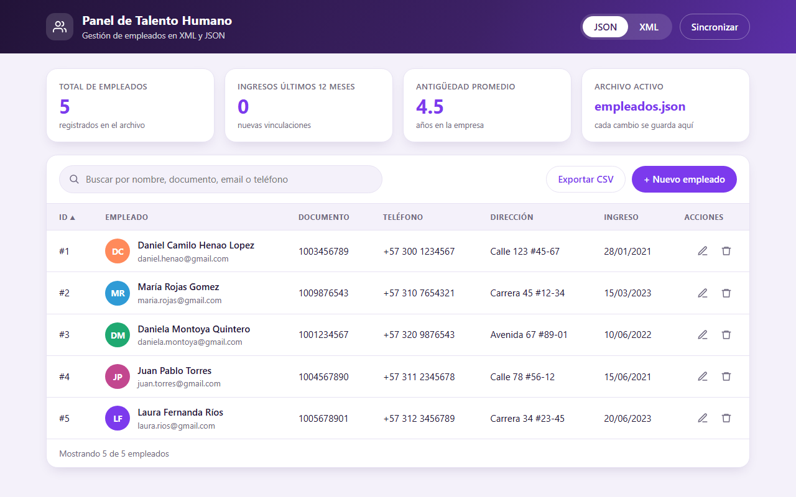
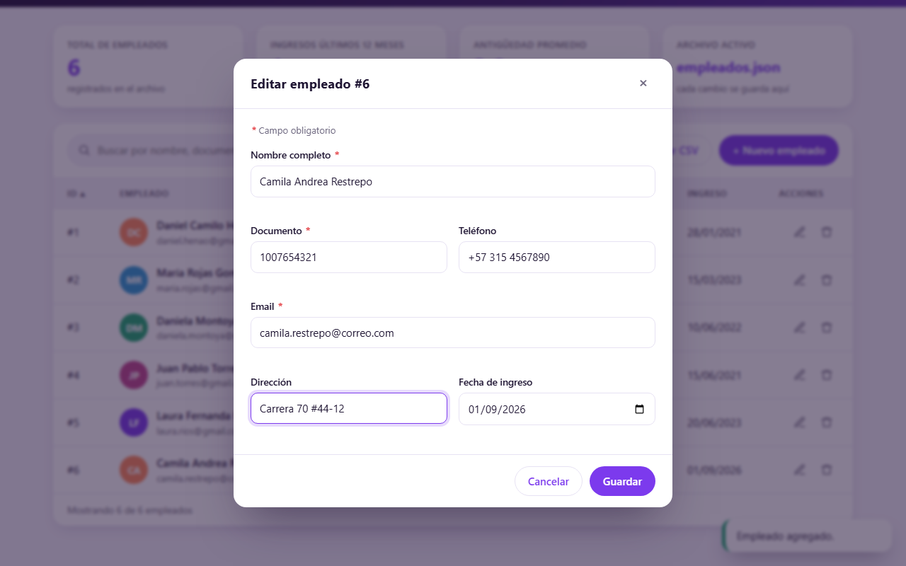

# CRUD de empleados con XML y JSON

Práctica 5 de **Herramientas de Programación III** (Institución Universitaria Pascual Bravo).
Aplicación que carga, muestra, agrega, edita y elimina empleados, guardándolos en un archivo **JSON** o **XML** a elección.

**Autora:** Valentina Alejandra Pérez Cardona
**Docente:** Edison Alberto Álvarez Taborda

**Demo en línea:** <https://herramientas-programacion-3-crud.onrender.com/>
(en el plan gratuito la primera carga puede tardar cerca de un minuto, y los cambios se pierden cuando el servicio se reinicia).

## Capturas

| Tabla de empleados (JSON) | Edición de un empleado | Vista en XML |
|---|---|---|
|  |  |  |

## Qué hace

- Lista los empleados leyéndolos de `empleados.json` o de `empleados.xml`.
- Agrega, edita y elimina empleados; el `IdEmpleado` se genera solo (autoincremental).
- Valida los campos antes de guardar: nombre, documento y email son obligatorios, el documento debe ser numérico, el email y el teléfono deben tener formato válido y la fecha debe ser `AAAA-MM-DD`.
- Permite elegir el formato de almacenamiento (JSON o XML), copiar los datos de un formato al otro (sincronizar) y exportarlos a CSV.

## Estructura de datos

Cada empleado tiene siete campos, iguales en ambos formatos:

| Campo | Tipo | Ejemplo |
|---|---|---|
| `IdEmpleado` | int | 1 |
| `strNombre` | string | Daniel Camilo Henao Lopez |
| `NumDocumento` | long | 1003456789 |
| `StrDireccion` | string | Calle 123 #45-67 |
| `StrTelefono` | string | +57 300 1234567 |
| `StrEmail` | string | daniel.henao@gmail.com |
| `DtmIngreso` | string (fecha ISO) | 2021-01-28 |

## Organización del código (capas)

| Archivo | Capa | Función |
|---|---|---|
| `modelo.py` | Modelo | Clase `Empleado` (dataclass) |
| `datos.py` | Datos | Lee y escribe XML (`ElementTree`) y JSON (`json`) |
| `app.py` | Servidor | Servidor web con API REST (`/api/empleados`) |
| `templates/` y `static/` | Interfaz web | HTML, CSS y JavaScript |
| `interfaz.py` | Interfaz de escritorio | Ventana de respaldo en tkinter |

## Cómo ejecutarlo en local

Solo necesita **Python 3.10 o superior**. No hay dependencias que instalar.

```bash
python app.py
```

Se abre en el navegador en <http://127.0.0.1:5000>. La ventana de escritorio de respaldo se ejecuta con `python interfaz.py`.

## Despliegue en Render

El proyecto incluye `render.yaml`. Para publicarlo:

1. Subir esta carpeta a un repositorio de GitHub.
2. En [Render](https://render.com), crear un **Web Service** a partir del repositorio (o un Blueprint, que lee `render.yaml`).
3. Comando de inicio: `python app.py`. Render entrega el puerto en la variable `PORT`, que `app.py` ya lee.

Nota: el almacenamiento de Render gratuito es temporal. Al reiniciarse el servicio, los archivos vuelven a los 5 empleados originales.
